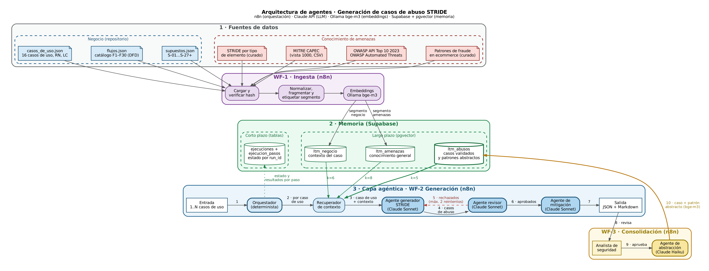

# STRIDE Abuse Agents

Reto 2 del *Challenge Cybersecurity Engineer (BISO)*: modelado de amenazas STRIDE del flujo de venta de productos voluminosos en un ecommerce, con una **arquitectura de agentes de IA con memoria de largo plazo** que genera, revisa y mitiga casos de abuso. La arquitectura está implementada (n8n + Supabase + Claude + Ollama) y se ejecutó sobre los 16 casos de uso del flujo.

📄 **Documento de entrega:** [`docs/Entrega_Reto2_STRIDE_Abuse_Agents.pdf`](docs/Entrega_Reto2_STRIDE_Abuse_Agents.pdf). Reúne todo lo de este repositorio en un solo archivo (164 páginas, con índice navegable).

## Resultados

| | |
|---|---|
| Casos de uso analizados | 16, sobre un diagrama de flujo de datos con 30 flujos y 6 límites de confianza |
| Casos de abuso generados | 90, todos aprobados por el agente revisor; **84 en alcance** tras la revisión del analista |
| Cobertura STRIDE | Las 6 categorías: T 28 · E 15 · S 14 · R 11 · I 11 · D 5 (casos en alcance) |
| Actores | 34 casos de empleados (propios y del proveedor logístico) · 51 de clientes y atacantes externos |
| Memoria de largo plazo | 84 casos validados con patrón abstracto (AV-0001 a AV-0084); 38 de los 90 casos se construyeron a partir de patrones de ejecuciones anteriores |
| Controles propuestos | 397, preventivos, detectivos y correctivos, con responsable |
| Riesgos principales | 8, priorizados; los tres primeros son privilegios internos sin segregación, evidencia que no prueba los hechos físicos y exposición de datos |
| Costo de la ejecución | ≈ 4.4 USD en llamadas a Claude (estimado con el precio publicado) |

## Arquitectura



- **Fuentes de datos:** los casos de uso, flujos y supuestos propios, más conocimiento de amenazas (MITRE CAPEC, OWASP API Top 10, OWASP Automated Threats y patrones de fraude curados), descargado en commits fijos.
- **Memoria:**
  - *Largo plazo* en Supabase + pgvector, en tres segmentos: negocio, amenazas y casos de abuso validados.
  - *Corto plazo:* un registro por ejecución y por paso.
- **Capa agéntica (n8n):**
  - Un orquestador determinista y un recuperador con cuotas por fuente.
  - Agentes con Claude: generador (prompt público de 96 palabras), revisor, mitigación y abstracción.
  - El analista aprueba qué entra a la memoria.

## Dónde está cada requisito

La matriz completa está en [`REQUISITOS.md`](REQUISITOS.md).

| Requisito del reto | Entregable |
|---|---|
| Diagrama del caso | [`docs/02-diagrama.md`](docs/02-diagrama.md) |
| Informe STRIDE: abusos de internos y externos, controles, riesgos principales | [`docs/08-informe-stride.md`](docs/08-informe-stride.md) |
| Arquitectura de agentes: memoria, memoria de largo plazo, fuentes de datos, capa agéntica | [`docs/03-arquitectura.md`](docs/03-arquitectura.md) |
| Implementación y evidencia de ejecución | [`docs/04`](docs/04-infraestructura.md) a [`docs/07`](docs/07-ejecucion.md), [`n8n/`](n8n), [`sql/`](sql), [`docs/evidencias/`](docs/evidencias) |
| Prompts de ≤100 palabras | [`prompts/README.md`](prompts/README.md) |
| Supuestos | [`docs/01`](docs/01-casos-de-uso-y-supuestos.md) §6, [`docs/03`](docs/03-arquitectura.md) §10, [`docs/08`](docs/08-informe-stride.md) §9 y anexo B |

## Documentos

| Archivo | Contenido |
|---|---|
| [`docs/01-casos-de-uso-y-supuestos.md`](docs/01-casos-de-uso-y-supuestos.md) | Actores, componentes, límites de confianza, 16 casos de uso y supuestos S-01 a S-27 |
| [`docs/02-diagrama.md`](docs/02-diagrama.md) | Diagrama de flujo de datos en tres vistas, zonas, límites de confianza y catálogo de flujos F1–F30 |
| [`docs/03-arquitectura.md`](docs/03-arquitectura.md) | Arquitectura de agentes: fuentes, memoria segmentada, capa agéntica, contratos, seguridad, costos y supuestos S-28 a S-35 |
| [`docs/04-infraestructura.md`](docs/04-infraestructura.md) | Instalación de n8n, Ollama y Supabase, credenciales, evidencias e incidencias |
| [`docs/05-memoria.md`](docs/05-memoria.md) | Fuentes de datos, fragmentos y flujo WF-1 de carga de la memoria de largo plazo |
| [`docs/06-agentes.md`](docs/06-agentes.md) | WF-2 (generación, revisión, mitigación) y WF-3 (consolidación en `ltm_abusos`) |
| [`docs/07-ejecucion.md`](docs/07-ejecucion.md) | Ejecución con Claude real: resultados, uso de la memoria, incidencias y evidencias |
| [`docs/08-informe-stride.md`](docs/08-informe-stride.md) | **Informe STRIDE** con el detalle de los 84 casos de abuso |

## Cómo reproducirlo

Requisitos: Linux con Podman o Docker y Compose, unos 6 GB de RAM libres, una cuenta de Supabase (plan gratuito) y una clave de la API de Claude con límite de gasto.

1. **n8n y Ollama**
   ```bash
   cd infra
   cp .env.example .env
   sed -i "s/^N8N_ENCRYPTION_KEY=.*/N8N_ENCRYPTION_KEY=$(openssl rand -hex 32)/" .env
   docker compose up -d
   docker compose exec ollama ollama pull bge-m3
   ```
   n8n queda en `http://localhost:5678`, accesible solo desde la propia máquina.
2. **Supabase:** en el SQL Editor, ejecutar `sql/001_esquema.sql`, `sql/004_permisos_service_role.sql` y `sql/005_capa_agentica.sql`. Se verifica con `sql/002_verificacion.sql`.
3. **Credenciales en n8n:**
   - *Supabase API:* Project URL y clave `sb_secret_…`.
   - *Ollama:* `http://ollama:11434`.
   - *Anthropic:* la clave de la API.
4. **Importar los flujos** de `n8n/`. En cada uno: poner la Project URL en el nodo **Configuración** y asignar las credenciales.
5. **Cargar la memoria:** ejecutar WF-1 (unos 15 minutos en CPU). Se verifica con `sql/003_verificar_memoria.sql`.
6. **Generar casos de abuso:** en WF-2, nodo **Entrada**, poner `["UC-11"]` o hasta 5 casos de uso y ejecutar. Para guardar en la memoria los casos aprobados, ejecutar WF-3 con el `run_id`.

Para regenerar los derivados:

| Qué | Comando |
|---|---|
| Fragmentos de memoria | `python3 scripts/generar_fuentes_negocio.py && python3 scripts/preparar_memoria.py` |
| Informe | `python3 scripts/catalogo.py && python3 scripts/generar_informe.py` |
| PDF | `python3 scripts/generar_pdf.py` (requiere pandoc, Chrome, `pypdf`, `reportlab` y `pillow`) |

## Seguridad del propio sistema

- Las claves (Claude, Supabase) solo existen cifradas dentro de las credenciales de n8n. `infra/.env` y los zip están en `.gitignore`.
- Supabase tiene RLS activado y sin políticas. Solo la clave secreta accede, y las funciones están retiradas a `anon` y `authenticated`.
- n8n escucha solo en `127.0.0.1`, y Ollama no publica puertos.
- Los agentes no tienen herramientas con efectos. El contenido variable va entre etiquetas como datos, y la salida está restringida por esquema (*structured outputs*).
- Solo WF-3 escribe en `ltm_abusos`, y siempre después de la aprobación de una persona.
- No se usaron datos reales de clientes.

## Fases

| Fase | Entregable | Estado |
|---|---|---|
| 1 | Casos de uso y supuestos | ✅ |
| 2 | Diagrama del flujo con límites de confianza | ✅ |
| 3 | Diseño de la arquitectura de agentes | ✅ |
| 4 | Infraestructura: n8n, Supabase, Ollama, API de Claude | ✅ |
| 5 | Carga de la memoria de largo plazo | ✅ |
| 6 | Agentes y prompts | ✅ |
| 7 | Ejecución y evidencias | ✅ |
| 8 | Informe de threat modeling STRIDE | ✅ |
| 9 | Extra opcional: mitigación implementada con agentes | No realizada |
| 10 | Documentación y entrega | ✅ |

## Estructura del repositorio

```
├── REQUISITOS.md            matriz de cumplimiento
├── data/                    casos de uso, flujos, supuestos, conocimiento, fragmentos de memoria, catálogo de casos de abuso
├── diagrams/                diagramas (Graphviz .dot, SVG, PNG)
├── docs/                    documentos 01–08, evidencias y PDF de entrega
├── infra/                   Compose de n8n y Ollama
├── n8n/                     flujos WF-1, WF-2 y WF-3
├── prompts/                 prompts y esquemas de salida
├── scripts/                 generación de fuentes, memoria, catálogo, informe y PDF
└── sql/                     esquema y consultas de Supabase
```
