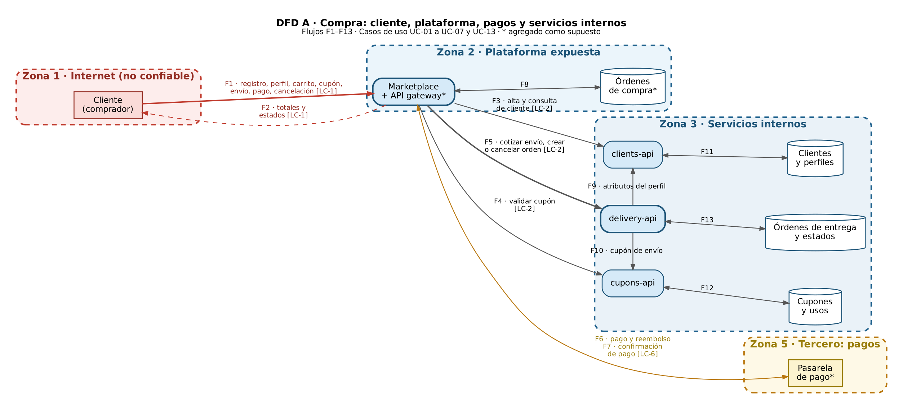
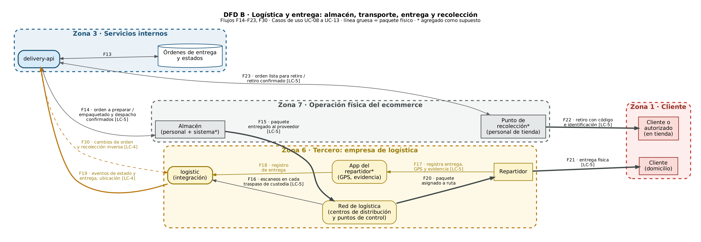
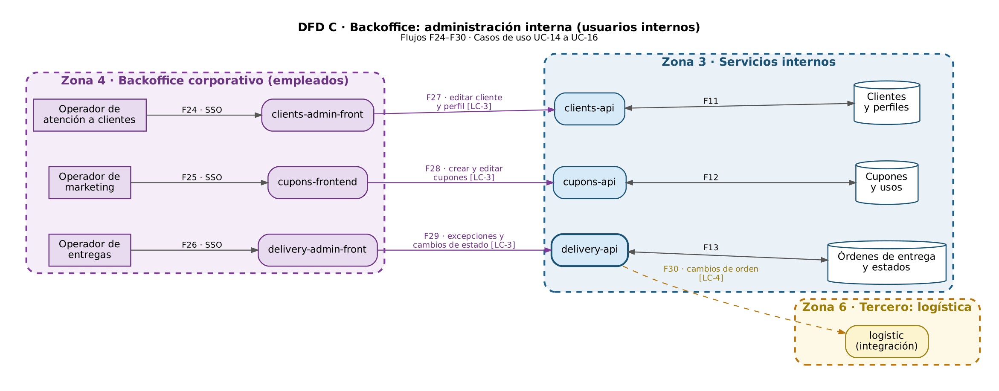

# Fase 2 · Diagrama del flujo con límites de confianza

Este documento cubre el requisito **C1** del reto: un diagrama que modele el caso y las interacciones entre actores y sistemas. Se usa un **diagrama de flujo de datos (DFD)** con límites de confianza, que es el formato sobre el que se aplica STRIDE en la Fase 8: cada elemento del diagrama (entidad, proceso, almacén de datos, flujo) se analiza contra las categorías de amenaza que le corresponden.

El caso tiene tres partes que se entienden mejor por separado, así que el modelo se divide en tres vistas que comparten zonas, identificadores de flujo (F1–F30) y límites de confianza (LC-1–LC-6):

| Vista | Qué muestra | Casos de uso |
|---|---|---|
| [DFD A · Compra](#dfd-a--compra) | Cliente, Marketplace, pasarela de pago y servicios internos | UC-01 a UC-07, UC-13 |
| [DFD B · Logística y entrega](#dfd-b--logística-y-entrega) | Almacén, proveedor logístico, repartidor, punto de recolección | UC-08 a UC-13 |
| [DFD C · Backoffice](#dfd-c--backoffice) | Empleados, frontends administrativos y APIs | UC-14 a UC-16 |

Los actores, componentes, casos de uso y supuestos están en [`01-casos-de-uso-y-supuestos.md`](01-casos-de-uso-y-supuestos.md).

## 1. Notación

| Símbolo | Significado |
|---|---|
| Rectángulo | Entidad externa (persona u organización que interactúa con el sistema) |
| Rectángulo redondeado | Proceso (componente de software que transforma datos) |
| Cilindro | Almacén de datos |
| Recuadro punteado de color | Zona de confianza; cada flujo que sale de un recuadro cruza un límite |
| Flecha con `[LC-#]` | Flujo que cruza un límite de confianza |
| Flecha gruesa gris (DFD B) | Movimiento físico del paquete (cadena de custodia) |
| Flecha punteada | Flujo de respuesta o asíncrono |
| `*` | Elemento que no aparece en el diagrama original del reto; se agrega como supuesto |

## 2. Zonas de confianza

| Zona | Contenido | Nivel de confianza |
|---|---|---|
| Zona 1 · Internet | Cliente (y cualquier atacante externo) | Ninguno: todo lo que envía es controlable por un atacante |
| Zona 2 · Plataforma expuesta | Marketplace + API gateway*, órdenes de compra* | Expuesta a internet; primera validación |
| Zona 3 · Servicios internos | clients-api, cupons-api, delivery-api y sus almacenes de datos | Alta; no expuestos a internet (S-24) |
| Zona 4 · Backoffice corporativo | Operadores internos y los tres frontends administrativos | Media: empleados autenticados con SSO, privilegios elevados (S-21) |
| Zona 5 · Tercero: pagos | Pasarela de pago* | Externa; se confía en sus confirmaciones firmadas (S-04, S-05) |
| Zona 6 · Tercero: logística | logistic, red de logística, repartidor, app del repartidor* | Externa; se confía en sus eventos con una credencial de servicio (S-06, S-15) |
| Zona 7 · Operación física | Almacén, punto de recolección* | Interna, pero los registros dependen de acciones físicas (S-27) |

## 3. Límites de confianza y flujos que los cruzan

| Límite | Descripción | Flujos | Por qué importa |
|---|---|---|---|
| LC-1 | Internet ↔ Marketplace | F1, F2 | Toda entrada del cliente es manipulable: precio, cupón, dirección, modalidad, identificadores de orden |
| LC-2 | Marketplace ↔ APIs internas | F3, F4, F5 | Si las APIs confían en lo que valida el Marketplace, un atacante que llama directo al gateway salta reglas |
| LC-3 | Empleados ↔ frontends ↔ APIs | F27, F28, F29 (F24–F26 con SSO) | Privilegio interno: crear cupones, editar perfiles y cambiar estados sin segunda aprobación |
| LC-4 | Logística ↔ delivery-api | F19, F30 | delivery-api acepta estados y entregas de un tercero; la credencial de servicio es compartida |
| LC-5 | Mundo físico ↔ sistemas | F14, F15, F16, F17, F21, F22, F23 | Un registro digital afirma algo físico (empaquetado, entregado, retirado) que el sistema no puede observar; aquí aplica RN-3 |
| LC-6 | Plataforma ↔ pasarela de pago | F6, F7 | Confirmaciones de pago y reembolsos: falsificar o repetir una confirmación crea órdenes no pagadas |

## 4. Diagramas

Las fuentes `.dot` están en [`diagrams/`](../diagrams); cada una se exporta a SVG (para el repositorio) y a PNG (para el PDF final).

### DFD A · Compra



### DFD B · Logística y entrega



### DFD C · Backoffice



## 5. Catálogo de flujos

| Flujo | Origen → destino | Datos | Casos de uso | Límite |
|---|---|---|---|---|
| F1 | Cliente → Marketplace | Credenciales, perfil, dirección y contacto, productos, cupón, modalidad de entrega, datos de pago, solicitud de cancelación | UC-01 a UC-07, UC-12, UC-13 | LC-1 |
| F2 | Marketplace → Cliente | Totales, costo de envío, estado de la orden, código de retiro | UC-02, UC-05, UC-07, UC-10, UC-12 | LC-1 |
| F3 | Marketplace → clients-api | Alta, consulta y actualización de cliente y dirección | UC-01, UC-03 | LC-2 |
| F4 | Marketplace → cupons-api | Código de cupón, cliente, carrito | UC-04 | LC-2 |
| F5 | Marketplace → delivery-api | Dirección, modalidad, cotización, creación y cancelación de la orden de entrega | UC-05, UC-06, UC-07, UC-13 | LC-2 |
| F6 | Marketplace → Pasarela de pago | Token del medio de pago, monto, solicitud de reembolso | UC-07, UC-13 | LC-6 |
| F7 | Pasarela de pago → Marketplace | Confirmación de pago o de reembolso (notificación) | UC-07, UC-13 | LC-6 |
| F8 | Marketplace ↔ Órdenes de compra | Productos, precios, cupón aplicado, total cobrado, referencia de pago | UC-02, UC-04, UC-07, UC-13 | — |
| F9 | delivery-api → clients-api | Atributos del perfil que determinan el costo de envío (RN-2) | UC-05 | — |
| F10 | delivery-api → cupons-api | Cupones de envío del cliente | UC-05 | — |
| F11 | clients-api ↔ Clientes y perfiles | Registro único del cliente (RN-1), perfil, direcciones | UC-01, UC-03, UC-14 | — |
| F12 | cupons-api ↔ Cupones y usos | Reglas del cupón, usos por cliente (RN-4) | UC-04, UC-15 | — |
| F13 | delivery-api ↔ Órdenes de entrega | Orden de entrega, estados, evidencia y ubicación de entrega | UC-05 a UC-13, UC-16 | — |
| F14 | delivery-api ↔ Almacén | Orden a preparar; confirmación de empaquetado y despacho | UC-08 | LC-5 |
| F15 | Almacén → Red de logística | Paquete físico entregado al proveedor | UC-08, UC-09 | LC-5 |
| F16 | Red de logística → logistic | Escaneos en cada traspaso de custodia | UC-09 | LC-5 |
| F17 | Repartidor → App del repartidor | Registro de entrega, ubicación GPS, foto o firma | UC-11 | LC-5 |
| F18 | App del repartidor → logistic | Registro de entrega con ubicación y evidencia | UC-11 | — |
| F19 | logistic → delivery-api | Eventos de estado, registro de entrega y ubicación (RN-3) | UC-09, UC-10, UC-11, UC-13 | LC-4 |
| F20 | Red de logística → Repartidor | Paquete físico asignado a ruta | UC-09, UC-11 | — |
| F21 | Repartidor → Cliente | Entrega física a domicilio | UC-11 | LC-5 |
| F22 | Punto de recolección → Cliente o autorizado | Entrega física contra código e identificación | UC-12 | LC-5 |
| F23 | delivery-api ↔ Punto de recolección | Orden lista para retiro; confirmación del retiro | UC-12 | LC-5 |
| F24 | Operador de atención → clients-admin-front | Sesión SSO | UC-14 | — |
| F25 | Operador de marketing → cupons-frontend | Sesión SSO | UC-15 | — |
| F26 | Operador de entregas → delivery-admin-front | Sesión SSO | UC-16 | — |
| F27 | clients-admin-front → clients-api | Edición de clientes y atributos del perfil | UC-14 | LC-3 |
| F28 | cupons-frontend → cupons-api | Creación y edición de cupones | UC-15 | LC-3 |
| F29 | delivery-admin-front ↔ delivery-api | Consulta de órdenes, excepciones y cambios de estado manuales | UC-16 | LC-3 |
| F30 | delivery-api → logistic | Cambios de orden y solicitudes de recolección inversa | UC-13, UC-16 | LC-4 |

## 6. Cómo se usa el diagrama en el análisis STRIDE

En un DFD, cada tipo de elemento está expuesto a un subconjunto de categorías STRIDE. Esta tabla define qué se evaluará en la Fase 8 para cada elemento:

| Tipo de elemento | Elementos del caso | Categorías aplicables |
|---|---|---|
| Entidad externa | Cliente, operadores, repartidor, pasarela, empresa de logística | **S** suplantación, **R** repudio |
| Proceso | Marketplace, las tres APIs, los tres frontends, logistic, app del repartidor | **S, T, R, I, D, E** (todas) |
| Almacén de datos | Órdenes de compra, clientes, cupones, órdenes de entrega | **T** manipulación, **R** repudio (si guarda registros), **I** divulgación, **D** denegación |
| Flujo de datos | F1–F30 | **T** manipulación, **I** divulgación, **D** denegación |

Del diagrama salen los puntos donde se concentrarán los casos de abuso, porque combinan un cruce de límite con una regla de negocio:

| Punto | Flujos | Regla | Pregunta que guía el análisis |
|---|---|---|---|
| Registro único del cliente | F1, F3, F11, F27 | RN-1 | ¿Qué identifica a un cliente como único y quién puede alterarlo? |
| Costo de envío por perfil | F5, F9, F27 | RN-2 | ¿Quién controla los atributos del perfil que bajan el costo de envío? |
| Cupones | F1, F4, F10, F12, F28 | RN-4 | ¿Dónde se valida el uso, la vigencia y el límite por cliente, y quién los crea? |
| Confirmación de pago | F6, F7, F8 | — | ¿Puede crearse una orden sin un pago confirmado por la pasarela? |
| Registro de entrega con ubicación | F17, F18, F19 | RN-3 | La ubicación la genera el dispositivo del repartidor: ¿cómo se comprueba que estaba ahí? |
| Cadena de custodia | F14, F15, F16, F20, F21, F22, F23 | — | ¿Quién puede registrar un traspaso que no ocurrió y cómo se detecta? |
| Cambios manuales de estado | F29, F30 | RN-3 | ¿Puede un empleado marcar una orden como entregada o cancelada sin evidencia ni aprobación? |
| Consistencia entre registros | F8, F13 | — | ¿Qué pasa si la orden de compra y la orden de entrega no coinciden (monto, estado, cancelación)? |

## 7. Supuestos agregados en esta fase

El modelado agregó dos supuestos al catálogo (sección 6.3 de [`01-casos-de-uso-y-supuestos.md`](01-casos-de-uso-y-supuestos.md)):

- **S-26:** el Marketplace guarda las órdenes de compra y delivery-api solo las órdenes de entrega; dos registros de la misma compra que deben ser consistentes.
- **S-27:** el almacén y el punto de recolección reciben las órdenes desde delivery-api y confirman cada paso de la cadena de custodia.

Los elementos marcados con `*` en los diagramas (API gateway, órdenes de compra, pasarela de pago, app del repartidor, punto de recolección, sistema del almacén) se apoyan en S-01, S-04, S-17, S-18, S-26 y S-27.

## 8. Regenerar los diagramas

Requiere Graphviz (`sudo apt install graphviz` en Kali):

```bash
cd diagrams
for f in dfd-a-compra dfd-b-logistica dfd-c-backoffice; do
  dot -Tsvg "$f.dot" -o "$f.svg"
  dot -Tpng -Gdpi=150 "$f.dot" -o "$f.png"
done
```
