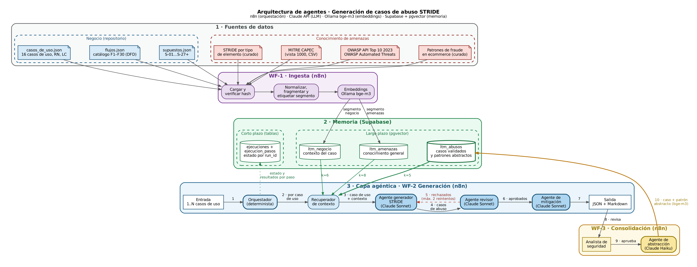

# Fase 3 · Arquitectura de agentes

Este documento describe la arquitectura de IA que soporta la generación de casos de abuso STRIDE para el flujo de venta de productos voluminosos. Cubre los requisitos **A1 a A4** del reto: memoria segmentada, memoria de largo plazo, fuentes de datos con su comunicación hacia la memoria, y capa agéntica. También fija el diseño que se implementa y se ejecuta en las Fases 4 a 7 (A5, A6), cómo soporta la proposición de casos de abuso (A7) y el lugar que ocupan los prompts de ≤100 palabras (B1 a B4c).

## 1. Vista general



El sistema recibe uno o varios casos de uso y devuelve, por cada uno, casos de abuso STRIDE ligados a ese caso de uso. Cada caso de abuso trae el actor, los pasos de cómo ocurre, el vector práctico y los controles propuestos. Está construido con tres flujos (*workflows*) de n8n:

| Flujo | Propósito | Cuándo corre | Usa LLM |
|---|---|---|---|
| **WF-1 · Ingesta** | Lleva las fuentes de datos a la memoria de largo plazo | Al inicio y cuando cambia una fuente | No |
| **WF-2 · Generación** | Capa agéntica: genera, revisa y mitiga casos de abuso | Cada vez que se analizan casos de uso | Sí: generador, revisor, mitigación |
| **WF-3 · Consolidación** | Guarda en memoria los casos aprobados por una persona, con un patrón abstracto | Después de revisar la salida de WF-2 | Sí: abstracción |

Las capas del diagrama corresponden a los componentes que pide el reto:

| Componente del reto | En esta arquitectura |
|---|---|
| Fuentes de datos (*Data Sources*) | Sección 3: negocio (repositorio) y conocimiento de amenazas (público y curado) |
| Memoria (*Memory*) con segmentación | Sección 4: corto plazo por ejecución y largo plazo en tres segmentos |
| Memoria de largo plazo (*Long-Term Memory*) | Sección 4.2: `ltm_negocio`, `ltm_amenazas`, `ltm_abusos` en Supabase con pgvector |
| Comunicación fuentes ↔ memoria | Sección 3.2: WF-1 (ingesta) y WF-3 (consolidación) |
| Capa agéntica (*Agentic Layer*) | Sección 5: orquestador, recuperador de contexto y tres agentes con LLM |

## 2. Decisiones de diseño

| Pieza | Elección | Por qué | Se puede cambiar por |
|---|---|---|---|
| Orquestación | **n8n** autoalojado (Podman en Kali) | Lo sugiere el reto; los flujos son visuales y exportables a JSON para el repositorio; cada ejecución queda registrada | LangGraph, código propio |
| LLM | **Claude** por API: Sonnet 5.5 (`claude-sonnet-5-5`) para generar, revisar y mitigar; Haiku 5.5 (`claude-haiku-5-5`) para abstraer | Buena relación entre razonamiento y costo; Haiku basta para resumir un caso en un patrón | Cualquier modelo con nodo de chat en n8n: el LLM es una pieza intercambiable y los prompts no dependen del proveedor |
| Embeddings | **Ollama** local con **bge-m3** (1024 dimensiones, multilingüe) | Anthropic no ofrece embeddings; un modelo local evita otra API de pago y no envía datos fuera. bge-m3 es multilingüe: los casos de uso están en español y CAPEC/OWASP en inglés | nomic-embed-text, embeddinggemma u otro; cambiarlo obliga a recalcular toda la memoria |
| Memoria | **Supabase** (PostgreSQL + pgvector) | Lo sugiere el reto; una sola base para la memoria vectorial y las tablas de corto plazo; n8n trae el nodo *Supabase Vector Store* | Postgres propio con pgvector, Qdrant |
| Orquestador | **Determinista** (lógica de n8n), no un LLM | El orden de los pasos es fijo; un orquestador determinista es auditable, reproducible y no gasta tokens | Un agente con herramientas, si se quisiera que decidiera los pasos |
| Recuperación | Paso fijo antes del generador, no una herramienta que el agente decide usar | Garantiza que el generador siempre consulte la memoria de largo plazo, que es obligatoria | Vector store como herramienta del agente |

## 3. Fuentes de datos

### 3.1 Catálogo

| Fuente | Segmento | Formato | Origen | Confianza |
|---|---|---|---|---|
| Casos de uso (UC-01 a UC-16), reglas RN-1 a RN-4, límites LC-1 a LC-6 | negocio | JSON | `data/casos_de_uso.json` (Fase 1) | Propia |
| Catálogo de flujos F1–F30 del DFD | negocio | JSON | `data/flujos.json`, generado del documento de la Fase 2 en la Fase 5 | Propia |
| Supuestos S-01 en adelante | negocio | JSON | `data/supuestos.json`, generado del documento de la Fase 1 en la Fase 5 | Propia |
| STRIDE por tipo de elemento del DFD | amenazas | Markdown | `data/conocimiento/stride.md`, redactado por nosotros | Propia |
| MITRE CAPEC, vista 1000 (*Mechanisms of Attack*) | amenazas | CSV | Descarga oficial de capec.mitre.org; se ingieren los patrones de abstracción *Meta* y *Standard* relacionados con lógica de negocio, autenticación, autorización y manipulación de datos | Pública |
| OWASP API Security Top 10 (2023) | amenazas | Markdown | Repositorio oficial de OWASP en GitHub | Pública |
| OWASP Automated Threats to Web Applications (OAT) | amenazas | Markdown | Repositorio oficial de OWASP en GitHub; relevantes: creación de cuentas, cracking de tokens (cupones), relleno de credenciales, *cashing out*, denegación de inventario | Pública |
| Patrones de fraude en ecommerce y logística | amenazas | Markdown | `data/conocimiento/fraude-ecommerce.md`, redactado por nosotros: fraude de reembolso, "no recibido", devolución de otro artículo, fraude interno con cupones, colusión con repartidores | Propia |

Las fuentes públicas no se copian al repositorio: `data/fuentes.json` guarda la URL fija de cada una y su hash SHA-256. WF-1 descarga, compara el hash y rechaza la fuente si cambió, para que nadie pueda alterar la memoria cambiando el contenido de una fuente.

### 3.2 Comunicación con la memoria

Las fuentes llegan a la memoria por un solo camino de escritura para cada segmento:

| Segmento | Quién escribe | Cómo |
|---|---|---|
| `ltm_negocio` | WF-1 | Cada caso de uso, flujo, supuesto, regla y límite es **un fragmento**. Así se recupera el elemento completo y sus metadatos (IDs relacionados) se pueden filtrar |
| `ltm_amenazas` | WF-1 | Cada patrón CAPEC, riesgo OWASP o patrón de fraude es un fragmento. Si pasa de unas 800 palabras se divide por sección y se repite el título en cada parte |
| `ltm_abusos` | WF-3 solamente | Un fragmento por caso de abuso aprobado por una persona, junto con su patrón abstracto |
| Corto plazo | Orquestador de WF-2 | Una fila por ejecución y una por paso de agente |

WF-1 es **idempotente**: cada fragmento lleva `fuente`, `id` y `hash` en sus metadatos; al reingerir una fuente, sus fragmentos anteriores se borran y se vuelven a insertar, sin duplicados.

## 4. Memoria

### 4.1 Segmentación

| Tipo | Segmento | Contenido | Vive | Lo consulta |
|---|---|---|---|---|
| Corto plazo | `ejecuciones`, `ejecucion_pasos` | Entrada de la ejecución, contexto recuperado, salida de cada agente, intentos, tokens usados | Por ejecución (`run_id`); se conserva como evidencia y auditoría | Orquestador (reintentos), analista |
| Largo plazo | `ltm_negocio` | Qué es el sistema: casos de uso, flujos, límites, reglas, supuestos | Permanente; cambia cuando cambia el caso | Recuperador de contexto |
| Largo plazo | `ltm_amenazas` | Cómo se ataca en general: STRIDE, CAPEC, OWASP, fraude | Permanente; cambia con las fuentes | Recuperador de contexto |
| Largo plazo | `ltm_abusos` | Qué ya encontramos: casos de abuso validados y su **patrón abstracto** | Crece con cada consolidación | Recuperador de contexto |

### 4.2 Esquema en Supabase

Las tres tablas de largo plazo tienen la misma forma. Cada una lleva su propia función de búsqueda, porque el nodo de n8n llama a la función por nombre (*Query Name*) y la función estándar `match_documents` tiene la tabla fija. Borrador (el script final se ejecuta en la Fase 4):

```sql
create extension if not exists vector;

create table ltm_amenazas (
  id        bigserial primary key,
  content   text  not null,
  metadata  jsonb not null,
  embedding vector(1024)            -- bge-m3
);

create function match_ltm_amenazas(
  query_embedding vector(1024),
  match_count int default 8,
  filter jsonb default '{}'
) returns table (id bigint, content text, metadata jsonb, similarity float)
language sql stable as $$
  select id, content, metadata, 1 - (embedding <=> query_embedding) as similarity
  from ltm_amenazas
  where metadata @> filter
  order by embedding <=> query_embedding
  limit match_count;
$$;

alter table ltm_amenazas enable row level security;  -- sin políticas: solo la clave de servicio accede
```

`ltm_negocio` y `ltm_abusos` se crean igual con `match_ltm_negocio` y `match_ltm_abusos`. Las tablas de corto plazo:

```sql
create table ejecuciones (
  run_id   uuid primary key default gen_random_uuid(),
  creada   timestamptz not null default now(),
  entrada  jsonb not null,
  estado   text not null check (estado in ('en_curso','completada','fallida')),
  modelos  jsonb,
  tokens   jsonb
);

create table ejecucion_pasos (
  id          bigserial primary key,
  run_id      uuid not null references ejecuciones(run_id),
  caso_de_uso text,
  agente      text not null,     -- recuperador | generador | revisor | mitigacion
  intento     int  not null default 1,
  entrada     jsonb,
  salida      jsonb,
  creada      timestamptz not null default now()
);
```

### 4.3 Metadatos por segmento

| Segmento | Metadatos |
|---|---|
| `ltm_negocio` | `tipo` (caso_de_uso, flujo, supuesto, regla, limite), `id`, `casos_de_uso` relacionados, `fuente`, `hash` |
| `ltm_amenazas` | `fuente` (capec, owasp-api, owasp-oat, stride, fraude), `id` (CAPEC-xxx, API6:2023, OAT-019…), `nombre`, `stride` (categorías asociadas), `hash` |
| `ltm_abusos` | `id` (AV-0001…), `caso_de_uso`, `stride`, `actor_tipo` (externo, interno, interno_tercero), `componentes`, `flujos`, `patron`, `run_id`, `aprobado_por`, `fecha` |

### 4.4 Cómo se consulta

Para cada caso de uso, el recuperador arma una consulta con el nombre, la descripción, los componentes, las reglas y los límites del caso de uso. Con esa consulta busca en los tres segmentos:

| Segmento | Resultados (k) | Filtro |
|---|---|---|
| `ltm_negocio` | 6 | Ninguno. Además, el caso de uso pedido se lee completo por su ID, sin búsqueda |
| `ltm_amenazas` | 8 | Ninguno |
| `ltm_abusos` | 5 | Ninguno. Así se recuperan también casos de **otros** casos de uso con el mismo patrón |

Los valores de k son iniciales y se ajustan en la Fase 7 según lo que devuelva cada búsqueda.

### 4.5 Por qué la memoria de largo plazo sirve para abstraer casos de abuso

El reto pide que el agente consulte la memoria de largo plazo para abstraer casos de abuso. Por eso `ltm_abusos` guarda dos cosas por cada caso aprobado:

1. **El caso concreto**, por ejemplo: *"El repartidor usa una app de ubicación simulada para registrar la entrega de UC-11 sin estar en el domicilio y se queda con el producto"*.
2. **El patrón abstracto**, que redacta el agente de abstracción en WF-3: *"Quien controla el dispositivo que genera la prueba de un evento físico puede falsificar esa prueba; el sistema confía en un dato generado del lado del cliente al cruzar LC-5."*

El caso concreto se busca por su parecido con el caso de uso que se analiza; el patrón se busca porque se aplica a otros. Cuando después se analiza UC-12 (recolección en tienda) o UC-08 (empaquetado en almacén), la búsqueda recupera ese patrón aunque no mencionen GPS. El generador lo aplica al nuevo caso de uso: la tienda marca un retiro que no ocurrió, o el almacén confirma un empaquetado que no se hizo. Así cada ejecución aprovecha lo aprendido en las anteriores y no repite casos ya validados.

## 5. Capa agéntica (WF-2)

### 5.1 Componentes

| Componente | Tipo | Responsabilidad |
|---|---|---|
| **Entrada** | Disparador de n8n (formulario o webhook autenticado) | Recibe 1 a 5 casos de uso: por ID (`UC-11`) o como texto libre con nombre y descripción |
| **Orquestador** | Lógica determinista de n8n | Valida la entrada, crea el `run_id`, procesa cada caso de uso, controla los reintentos (máximo 2), guarda cada paso en la memoria de corto plazo y arma la salida |
| **Recuperador de contexto** | Nodo *Supabase Vector Store* (modo *Get Many*) + embeddings bge-m3 | Arma la consulta y trae el contexto de los tres segmentos (sección 4.4) |
| **Agente generador STRIDE** | Claude Sonnet 5.5 | Genera **al menos un** caso de abuso por caso de uso, con el prompt de ≤100 palabras y el contexto recuperado |
| **Agente revisor** | Claude Sonnet 5.5 + validaciones deterministas | Aprueba o rechaza cada caso según los criterios de la sección 5.3; los rechazados vuelven al generador con las observaciones |
| **Agente de mitigación** | Claude Sonnet 5.5 | Propone controles preventivos, detectivos y correctivos para cada caso aprobado y estima su riesgo |
| **Salida** | Nodo de n8n | Devuelve el resultado en JSON y en Markdown y cierra la ejecución |
| **Agente de abstracción** (WF-3) | Claude Haiku 5.5 | Convierte cada caso aprobado por el analista en un patrón abstracto para `ltm_abusos` |

Los agentes **no tienen herramientas con efectos**: no escriben en la memoria, no llaman a otros sistemas y no ejecutan código. Solo reciben texto y devuelven JSON. Las escrituras las hace el orquestador (corto plazo) o WF-3 (largo plazo).

### 5.2 Contratos

**Entrada de WF-2:**

```json
{
  "casos_de_uso": [
    "UC-11",
    { "id": "UC-X1", "nombre": "Cambio de dirección después del pago", "descripcion": "..." }
  ]
}
```

**Salida del generador**, un objeto por caso de abuso:

```json
{
  "id": "AC-UC11-01",
  "caso_de_uso": "UC-11",
  "titulo": "Registro de entrega con ubicación simulada",
  "stride": { "principal": "S", "secundarias": ["R"] },
  "actor": { "tipo": "interno_tercero", "rol": "Repartidor" },
  "elementos_dfd": ["F17", "F18", "F19"],
  "limites_confianza": ["LC-5", "LC-4"],
  "precondiciones": ["La app acepta la ubicación que reporta el sistema operativo del teléfono"],
  "como_ocurre": [
    "1. El repartidor activa una app de ubicación simulada en un teléfono con opciones de desarrollador",
    "2. Fija las coordenadas del domicilio del cliente",
    "3. Registra la entrega desde otro lugar; la app envía esa ubicación a logistic (F18)",
    "4. delivery-api recibe el evento (F19), valida RN-3 contra el radio de tolerancia y marca la orden como entregada"
  ],
  "vector_practico": "App de ubicación simulada en Android con 'ubicación de prueba' habilitada; no requiere acceso a sistemas del ecommerce",
  "impacto": "Pérdida del producto, reembolso o reenvío a costa del ecommerce, reclamo del cliente",
  "referencias": ["CAPEC-xxx", "OAT-xxx"],
  "patrones_usados": ["AV-0003"],
  "supuestos": ["S-17"]
}
```

`referencias` es complementario: el reto pide vectores prácticos, no solo CWE, CVE o riesgos genéricos, así que un caso sin `como_ocurre` y `vector_practico` concretos se rechaza aunque cite un CAPEC.

**Salida del revisor:**

```json
{
  "id": "AC-UC11-01",
  "veredicto": "aprobado",
  "criterios": { "R1": true, "R2": true, "R3": true, "R4": true, "R5": true, "R6": true, "R7": true },
  "observaciones": ""
}
```

**Salida de la mitigación:**

```json
{
  "id": "AC-UC11-01",
  "riesgo": { "probabilidad": 3, "impacto": 3, "nivel": "alto" },
  "controles": [
    { "tipo": "preventivo", "control": "Atestación del dispositivo y detección de ubicación simulada en la app del repartidor", "responsable": "Proveedor logístico" },
    { "tipo": "detectivo", "control": "Comparar la trayectoria de la ruta con la ubicación del registro; alertar saltos imposibles", "responsable": "Ecommerce (delivery-api)" },
    { "tipo": "correctivo", "control": "Confirmación del cliente con código de entrega antes de cerrar la orden", "responsable": "Ecommerce" }
  ]
}
```

El riesgo usa una escala de 1 a 3 para probabilidad e impacto; el nivel sale de su producto (1–2 bajo, 3–4 medio, 6–9 alto). La matriz definitiva se documenta con el informe STRIDE de la Fase 8.

### 5.3 Criterios del revisor

Cada criterio sale de un requisito del documento del reto:

| Criterio | Qué revisa | Requisito | Quién lo revisa |
|---|---|---|---|
| R1 | El caso cita un caso de uso que está en la entrada | B4a: la salida referencia el caso de uso vinculado | Validación determinista |
| R2 | El JSON cumple el contrato y cada caso de uso de la entrada tiene al menos un caso de abuso | B2, B3 | Validación determinista (en el orquestador) |
| R3 | `como_ocurre` describe pasos concretos sobre componentes y flujos del caso, no una descripción general | B4b: explicar claramente cómo ocurre | LLM |
| R4 | `vector_practico` es ejecutable: qué hace el actor, con qué y sobre qué dato; no es solo un CWE, CVE o riesgo genérico | B4c | LLM |
| R5 | La categoría STRIDE corresponde al elemento del DFD afectado (sección 6 de la Fase 2) | C2 | LLM |
| R6 | Es coherente con los supuestos o declara uno nuevo | C4 | LLM |
| R7 | No repite un caso ya validado en `ltm_abusos`; si lo extiende, lo cita en `patrones_usados` | A2 | LLM |

## 6. Recorrido de una ejecución

Ejemplo con la entrada `["UC-11", "UC-12"]`:

1. **Entrada.** El analista envía los dos casos de uso.
2. **Orquestador.** Valida que existan, crea el `run_id` en `ejecuciones` y procesa cada caso de uso.
3. **Recuperador.** Para UC-11 lee el caso completo de `ltm_negocio` y busca en los tres segmentos: trae F17–F19, S-17, RN-3, patrones de suplantación de CAPEC y, si existe, el patrón AV-0003 de ubicación falsificada.
4. **Generador.** Recibe el prompt de ≤100 palabras, el caso de uso y el contexto entre delimitadores. Devuelve, por ejemplo, tres casos de abuso para UC-11.
5. **Revisor.** Aprueba dos y rechaza uno porque su vector es genérico ("explotar una vulnerabilidad en la app").
6. **Reintento.** El orquestador devuelve el caso rechazado al generador con la observación. Si después de 2 reintentos sigue rechazado, se descarta y queda registrado en `ejecucion_pasos`.
7. **Mitigación.** Propone controles y riesgo para cada caso aprobado.
8. **Salida.** Se repite para UC-12 y se entrega el resultado de ambos en JSON y Markdown. La ejecución queda en estado `completada`.
9. **Consolidación (WF-3).** El analista revisa la salida y aprueba los casos que quiere conservar. El agente de abstracción redacta el patrón de cada uno, se calcula su embedding y se inserta en `ltm_abusos` con `aprobado_por` y `run_id`.

## 7. Los prompts de ≤100 palabras

El reto pide prompts de máximo 100 palabras, utilizables en cualquier LLM público, que acepten uno o más casos de uso y generen al menos un caso de abuso por cada uno (B1 a B4). En esta arquitectura:

- El **prompt del generador es el mismo** que se entrega como prompt público. En un LLM público, el usuario pega el prompt y después los casos de uso.
- En el sistema de agentes, n8n agrega después del prompt **datos**, no instrucciones: el caso de uso y el contexto recuperado, entre delimitadores (`<caso_de_uso>`, `<contexto>`), y el formato JSON de salida que exige el parser estructurado de n8n.
- Los prompts del revisor, de la mitigación y de la abstracción son internos del sistema y también se documentan en la Fase 6.

## 8. Seguridad del propio sistema de agentes

El sistema que analiza amenazas también tiene las suyas. Resumen con STRIDE:

| Amenaza | Ejemplo | Control |
|---|---|---|
| **S** Suplantación | Alguien invoca WF-2 o WF-3 sin ser el analista | n8n escucha solo en `127.0.0.1`, con cuenta de propietario; webhooks con autenticación por encabezado |
| **T** Manipulación | Envenenar la memoria: alterar una fuente o consolidar un caso falso | Hash SHA-256 de cada fuente pública; solo WF-3 escribe `ltm_abusos` y solo tras aprobación humana; cada fragmento guarda su origen |
| **R** Repudio | No saber quién aprobó un caso o qué modelo lo generó | `ejecuciones` y `ejecucion_pasos` guardan entradas, salidas, modelos y tokens; `ltm_abusos` guarda `aprobado_por` y `run_id` |
| **I** Divulgación | Fuga de la clave de la API de Claude o de la clave de servicio de Supabase | Claves solo en las credenciales cifradas de n8n (`N8N_ENCRYPTION_KEY`); `.env` fuera del repositorio; RLS activado en Supabase; no se usan datos reales de clientes |
| **D** Denegación | Gasto descontrolado por un bucle o una entrada enorme | Límite de gasto en la consola de Claude; máximo 5 casos de uso por ejecución, 2 reintentos y `max_tokens` por llamada |
| **E** Elevación | Inyección de instrucciones en un caso de uso de texto libre o en el contenido de una fuente | El contenido va entre delimitadores y se declara como datos; los agentes no tienen herramientas con efectos; la salida se valida contra el esquema; revisión humana antes de escribir en la memoria de largo plazo |

## 9. Costo estimado

Estimación por caso de uso con Sonnet 5.5 (2 USD por millón de tokens de entrada y 10 USD por millón de salida), incluyendo un reintento:

| Agente | Entrada aprox. | Salida aprox. |
|---|---|---|
| Generador | 8 000 tokens | 3 000 tokens |
| Revisor | 5 000 tokens | 1 000 tokens |
| Mitigación | 4 000 tokens | 2 000 tokens |
| **Total** | ~17 000 tokens ≈ 0.03 USD | ~6 000 tokens ≈ 0.06 USD |

Unos **0.10 a 0.15 USD por caso de uso**, es decir, entre 2 y 3 USD para analizar los 16 casos de uso. El razonamiento adaptativo del modelo cuenta como tokens de salida y puede subir la cifra, así que se recomienda un límite de gasto de 10 a 20 USD. Los embeddings no cuestan nada porque corren en Ollama local.

## 10. Supuestos de la arquitectura

| ID | Supuesto | Implicación |
|---|---|---|
| S-28 | Las fuentes públicas (CAPEC, OWASP) son confiables en su origen, pero su contenido se trata siempre como datos y nunca como instrucciones | Una fuente alterada no puede cambiar el comportamiento de los agentes; el hash detecta cambios |
| S-29 | El orden de los pasos de WF-2 es fijo, por eso el orquestador es determinista y no un LLM | Ejecuciones reproducibles y auditables; si se quisiera un orquestador autónomo, se cambia ese nodo |
| S-30 | Una persona (el analista de seguridad) revisa la salida antes de consolidar casos en `ltm_abusos` | La memoria de largo plazo solo crece con casos validados; evita que errores del modelo se refuercen |
| S-31 | Los embeddings se calculan con bge-m3 en Ollama local (1024 dimensiones) | Cambiar de modelo obliga a recalcular las tres tablas de largo plazo |
| S-32 | Supabase se usa en un proyecto dedicado del plan gratuito, sin datos reales de clientes | Los límites del plan gratuito se verifican en la Fase 4 |
| S-33 | n8n y Ollama corren en la VM Kali con Podman y solo son accesibles desde la propia VM | Sin exposición a internet; las evidencias se capturan localmente |
| S-34 | Los modelos de Claude se eligen por ID fijo (`claude-sonnet-5-5`, `claude-haiku-5-5`) | Los resultados no cambian por una actualización silenciosa del modelo; si el nodo de n8n no lista el modelo, se escribe el ID |
| S-35 | El formato JSON de salida lo agrega el parser estructurado de n8n y no forma parte del prompt de ≤100 palabras | El prompt público sigue funcionando en cualquier LLM, que responderá en texto con las mismas secciones |

## 11. Trazabilidad con los requisitos

| Requisito | Dónde se cumple |
|---|---|
| A1 Memoria y su segmentación | Secciones 4.1 a 4.3 |
| A2 Memoria de largo plazo que el agente consulta para abstraer casos de abuso | Secciones 4.4 y 4.5 |
| A3 Fuentes de datos y su comunicación con la memoria | Sección 3 |
| A4 Capa agéntica | Sección 5 |
| A5 Implementación | Fases 4 a 6, sobre este diseño |
| A6 Pruebas de la ejecución | Fase 7 |
| A7 Soportar la proposición de casos de abuso | Secciones 5.2 y 6: cada caso de abuso es trazable a su caso de uso, elementos del DFD y ejecución |
| B1 a B4c Prompts | Sección 7 y criterios R1 a R4 de la sección 5.3; los prompts se escriben en la Fase 6 |
| C4 Supuestos | Sección 10 |
