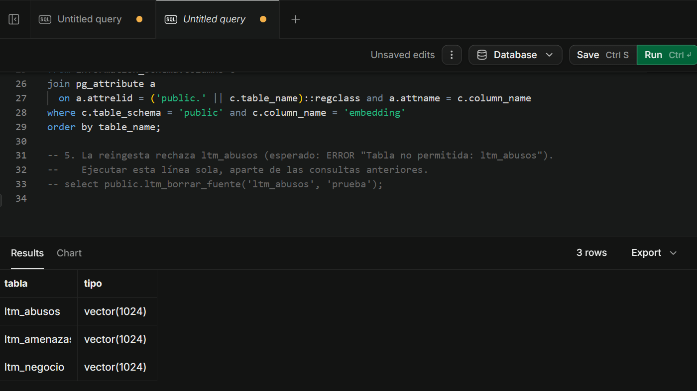
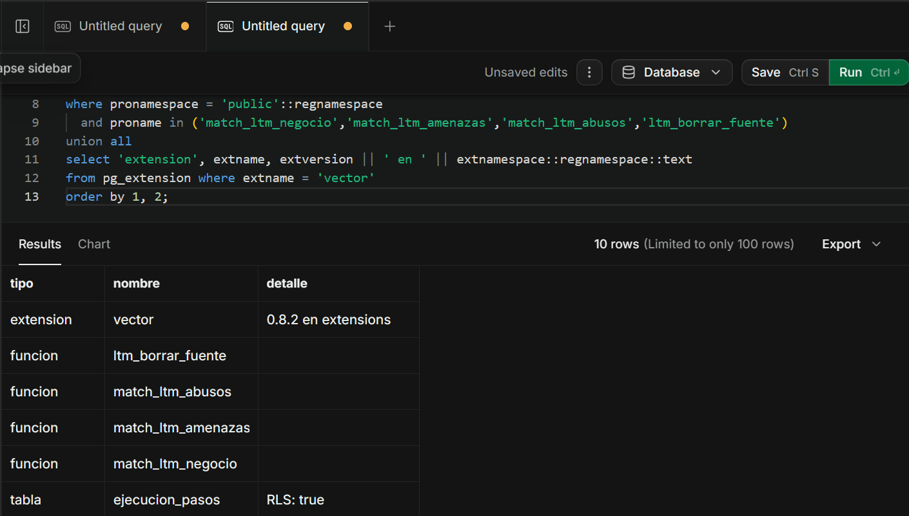
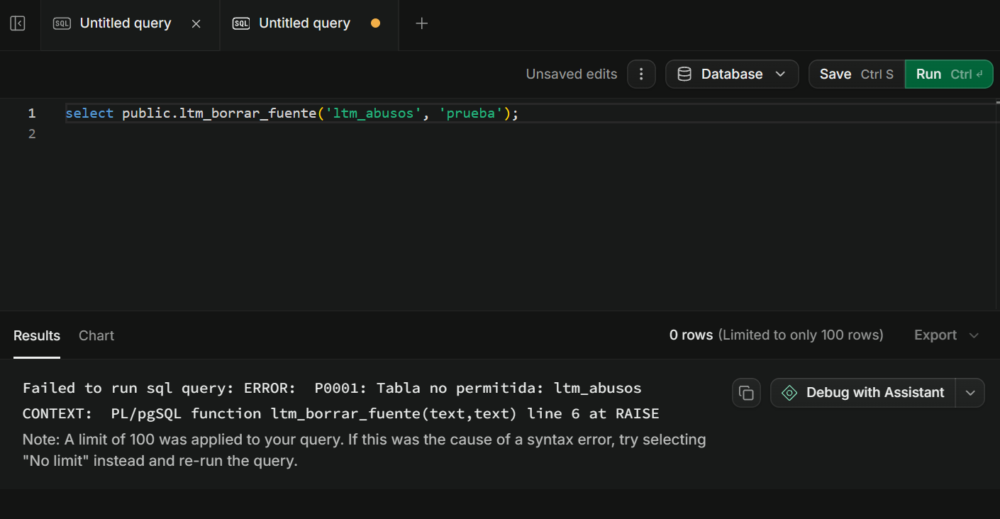

# Fase 4 · Infraestructura

Esta fase instala la infraestructura que soporta la arquitectura de la Fase 3 ([`03-arquitectura.md`](03-arquitectura.md)). Es la base de la implementación que pide el requisito **A5**.

| Pieza | Dónde corre | Versión | Archivo |
|---|---|---|---|
| n8n (orquestación) | VM Kali, contenedor rootless con Podman | 2.48.6 | [`infra/docker-compose.yml`](../infra/docker-compose.yml) |
| Ollama + bge-m3 (embeddings) | VM Kali, contenedor rootless con Podman | Ollama 0.40.17 | [`infra/docker-compose.yml`](../infra/docker-compose.yml) |
| Supabase + pgvector (memoria) | Nube de Supabase, plan gratuito | pgvector 0.8.2 | [`sql/001_esquema.sql`](../sql/001_esquema.sql) |
| Claude (LLM) | API de Anthropic | Sonnet 5.5, Haiku 5.5 | Credencial en n8n |

## 1. Requisitos de la VM

- **6 GB de RAM** y 4 núcleos. Con 2 GB, n8n y el modelo de embeddings no caben juntos en memoria.
- Unos 10 GB libres en disco. Solo la imagen de Ollama pesa unos 3.4 GB, porque incluye librerías para tarjetas gráficas.
- Podman con su socket de usuario activo (`systemctl --user enable --now podman.socket`), igual que en el Reto 1.

## 2. n8n y Ollama

```bash
cd infra
cp .env.example .env
sed -i "s/^N8N_ENCRYPTION_KEY=.*/N8N_ENCRYPTION_KEY=$(openssl rand -hex 32)/" .env
docker compose up -d
docker compose exec ollama ollama pull bge-m3
```

Decisiones de configuración:

| Decisión | Motivo |
|---|---|
| n8n publicado solo en `127.0.0.1:5678` | No queda expuesto a la red (supuesto S-33) |
| Ollama sin puertos publicados | Solo n8n lo usa, por la red interna (`http://ollama:11434`) |
| `N8N_ENCRYPTION_KEY` definida en `.env`, fuera del repositorio | Cifra las credenciales guardadas en n8n; si se pierde, hay que volver a capturarlas |
| `OLLAMA_MAX_LOADED_MODELS=1`, `OLLAMA_NUM_PARALLEL=1` | Limitar el uso de RAM en una VM de 6 GB |
| `N8N_RESTRICT_FILE_ACCESS_TO=/files` y `data/` montado de solo lectura | Los nodos de archivos solo pueden leer las fuentes de datos del repositorio |
| Telemetría de n8n desactivada | No enviar datos de uso a terceros |
| Imagen de n8n tomada de `ghcr.io` | Docker Hub limita las descargas sin sesión iniciada |
| Versiones fijas de las imágenes | Reproducibilidad: una actualización no cambia el comportamiento sin que nos demos cuenta |

Comprobación de que n8n llega a Ollama y de que el modelo devuelve vectores del tamaño correcto:

```bash
docker compose exec n8n node -e "fetch('http://ollama:11434/api/embed',{method:'POST',body:JSON.stringify({model:'bge-m3',input:'prueba de embeddings'})}).then(r=>r.json()).then(j=>console.log('dimensiones:', j.embeddings[0].length))"
```

Resultado obtenido: `dimensiones: 1024`.

La cuenta de propietario de n8n es local y no tiene servidor de correo: si se olvida la contraseña, se reinicia con `docker compose exec n8n n8n user-management:reset`.

## 3. Supabase

1. Proyecto `stride-abuse-agents` en el plan gratuito, sin datos reales (supuesto S-32).
2. En el SQL Editor se ejecuta [`sql/001_esquema.sql`](../sql/001_esquema.sql). Crea:
   - las tablas de memoria de largo plazo `ltm_negocio`, `ltm_amenazas` y `ltm_abusos`, con vectores de 1024 dimensiones e índices HNSW por similitud de coseno;
   - las funciones de búsqueda `match_ltm_*`, que el nodo *Supabase Vector Store* de n8n llama por nombre;
   - `ltm_borrar_fuente`, para que la reingesta no duplique fragmentos. Solo acepta `ltm_negocio` y `ltm_amenazas`, porque `ltm_abusos` solo la escribe WF-3;
   - las tablas de memoria de corto plazo `ejecuciones` y `ejecucion_pasos`;
   - RLS activado sin políticas, y permisos de las funciones retirados a `anon` y `authenticated`. Solo la clave secreta, que vive en n8n, tiene acceso.
3. El script es idempotente. Antes de ejecutarlo en Supabase se probó en PostgreSQL 16 con pgvector: corre dos veces sin error, las búsquedas devuelven el fragmento más parecido, el borrado por fuente funciona y los roles públicos no tienen acceso.
4. La verificación se hace con [`sql/002_verificacion.sql`](../sql/002_verificacion.sql) y una consulta que muestra todo en una sola tabla.

## 4. Credenciales en n8n

| Credencial | Valor | Notas |
|---|---|---|
| Supabase API | Host = Project URL (`https://<ref>.supabase.co`), Secret Key = clave `sb_secret_…` | Se usan las claves nuevas de Supabase, no las antiguas `anon` / `service_role` |
| Ollama | Base URL = `http://ollama:11434` | Nombre del servicio en la red de Compose |
| Anthropic | Clave `n8n-reto2` creada en platform.claude.com | Límite de gasto mensual configurado en la consola |

Las claves solo existen dentro de las credenciales cifradas de n8n. No están en el repositorio, en capturas ni en documentos.

## 5. Evidencias

| # | Evidencia | Resultado |
|---|---|---|
| 1 | Embedding de prueba desde el contenedor de n8n | `dimensiones: 1024` |
| 2 | Columnas `embedding` de las tablas de largo plazo | 3 tablas con `vector(1024)` |
| 3 | Tablas, funciones y extensión | 10 filas: 5 tablas con RLS activado, 4 funciones, `vector` 0.8.2 en `extensions` |
| 4 | Reingesta sobre `ltm_abusos` | Rechazada: `Tabla no permitida: ltm_abusos` |
| 5 | Credenciales de Supabase, Ollama y Anthropic en n8n | Las tres con conexión probada |







## 6. Incidencias y cómo se resolvieron

| Incidencia | Causa | Solución |
|---|---|---|
| La VM tenía 1.9 GB de RAM | Configuración inicial de la VM | Se subió a 6 GB y 4 núcleos; el equipo tiene 16 GB |
| `toomanyrequests` al descargar n8n | Límite de descargas sin sesión iniciada de Docker Hub | Se usa la imagen de n8n de `ghcr.io` |
| `infra/.env` apareció en `git add` | Faltaba el `.gitignore` (archivo oculto que no se copió) | Se sacó del área de preparación y se restauró el `.gitignore` antes del commit; el `.env` nunca se subió |
| El editor de Supabase solo mostraba el último resultado | El editor muestra una sola tabla de resultados por ejecución | Consulta única con `union all` |
| `permission denied for table ltm_amenazas` al ejecutar WF-1 (Fase 5) | El proyecto de Supabase no da permisos automáticos a las tablas creadas desde el SQL Editor, así que `service_role` no podía leer ni escribir | Permisos explícitos para `service_role` (y retirados a `anon` / `authenticated`) en [`sql/004_permisos_service_role.sql`](../sql/004_permisos_service_role.sql); también se agregaron a `001_esquema.sql` |
| La carpeta del proyecto se reemplazó al descomprimir una entrega: se perdieron `infra/.env` y `.gitignore`, y n8n dejó de ver `data/` | Se movió la carpeta completa en lugar de sobrescribir archivos | Se recuperó la llave desde el contenedor en ejecución (`printenv N8N_ENCRYPTION_KEY`), se restauró el `.gitignore` y se reinició n8n. Las entregas se descomprimen con `unzip -o` sobre el repositorio |
