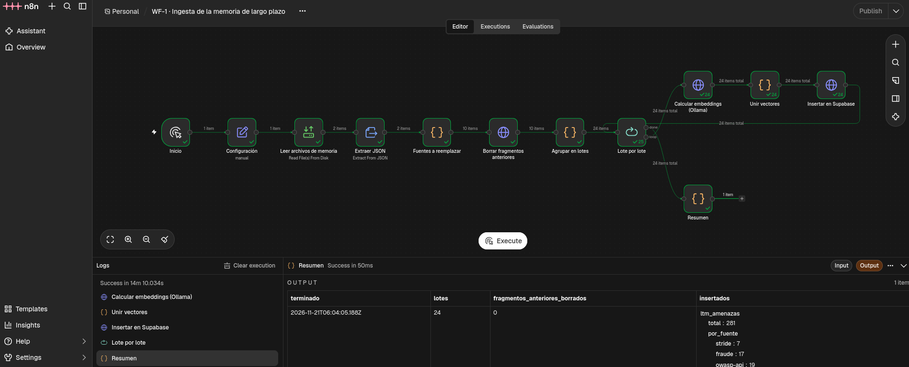
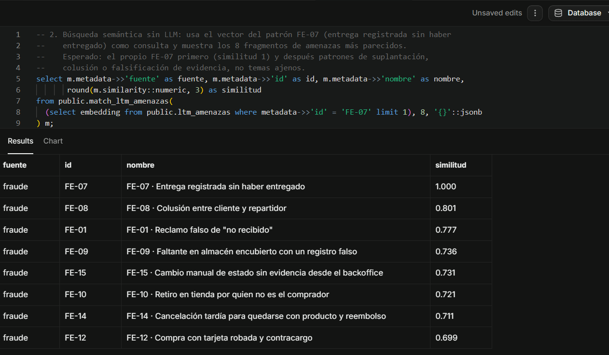
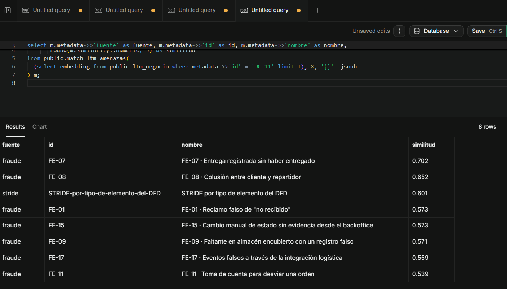
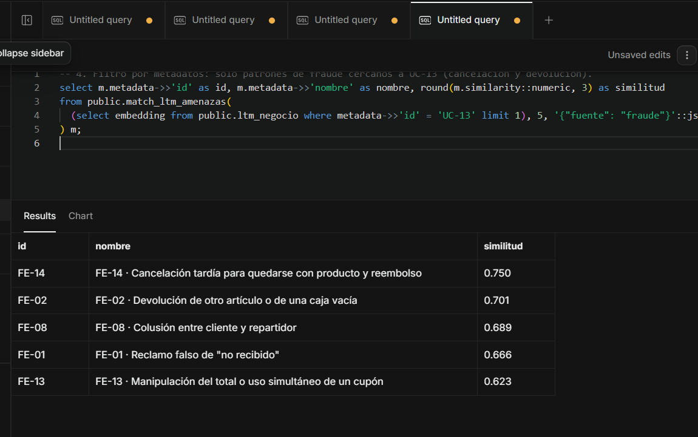

# Fase 5 · Carga de la memoria de largo plazo

Esta fase implementa el componente de **fuentes de datos** y su comunicación con la **memoria de largo plazo** (requisitos A2 y A3), según el diseño de [`03-arquitectura.md`](03-arquitectura.md). El resultado son dos segmentos cargados en Supabase: `ltm_negocio` (91 fragmentos) y `ltm_amenazas` (281 fragmentos). El tercero, `ltm_abusos`, se llena en la Fase 6 con WF-3.

## 1. Recorrido de los datos

```
Fuentes del negocio (docs + JSON)  ┐
Documentos curados (stride, fraude)├─► scripts/preparar_memoria.py ─► data/memoria/*.json ─► WF-1 (n8n) ─► Ollama bge-m3 ─► Supabase
OWASP y CAPEC en un commit fijo    ┘          (normaliza y fragmenta)       (+ data/fuentes.json)         (embeddings)     (ltm_negocio, ltm_amenazas)
```

La preparación de los fragmentos (Python) está separada de la carga (n8n):
- **Python** descarga, filtra, limpia y fragmenta. Así el resultado es un archivo revisable en el repositorio, y la carga siempre recibe el mismo contenido.
- **n8n** solo lee los fragmentos, calcula los embeddings y escribe en la memoria. Así el flujo es corto y fácil de auditar.

## 2. Fuentes

### 2.1 Del negocio (propias)

| Archivo | Contenido | Se genera con |
|---|---|---|
| `data/casos_de_uso.json` | 16 casos de uso, reglas RN-1 a RN-4, límites LC-1 a LC-6 | Fase 1 |
| `data/flujos.json` | Flujos F1–F30 del DFD: origen, destino, datos, casos de uso, límite que cruzan | `scripts/generar_fuentes_negocio.py`, a partir de `docs/02-diagrama.md` |
| `data/supuestos.json` | Supuestos S-01 a S-35 con su implicación y los casos de uso que los citan | El mismo script, a partir de `docs/01` y `docs/03` |

### 2.2 Conocimiento de amenazas

| Fuente | Origen | Filtro | Fragmentos | STRIDE en metadatos |
|---|---|---|---|---|
| STRIDE aplicado al DFD | `data/conocimiento/stride.md` (propio) | — | 7 | Por categoría |
| Patrones de fraude en ecommerce y logística (FE-01 a FE-17) | `data/conocimiento/fraude-ecommerce.md` (propio) | — | 17 | Escrito en cada patrón |
| OWASP API Security Top 10 2023 | `OWASP/API-Security`, commit `33cea37` | Los 10 riesgos | 19 (divididos por sección) | Asignado por el proyecto |
| OWASP Automated Threats (OAT) | `OWASP/www-project-automated-threats-to-web-applications`, commit `14da2ff` | Las 20 amenazas vigentes (se excluye la versión antigua de OAT-003) | 20 | Asignado por el proyecto |
| MITRE CAPEC | `mitre/cti`, commit `e79c7c5` | Patrones vigentes, abstracción *Meta* o *Standard*, dominio *Software* o *Ingeniería social* | 218 | Derivado de las consecuencias del patrón |

CAPEC se toma del repositorio oficial de MITRE en GitHub (formato STIX 2.1), no del CSV del sitio de CAPEC. El contenido es el mismo, pero el repositorio permite fijar un commit. De cada consecuencia de CAPEC se deriva la categoría STRIDE: *Authentication* → S, *Integrity* → T, *Non-Repudiation* → R, *Confidentiality* → I, *Availability* → D, *Access Control* / *Authorization* → E.

Las licencias y la atribución están en [`data/conocimiento/LICENCIAS.md`](../data/conocimiento/LICENCIAS.md).

### 2.3 Integridad de las fuentes

`data/fuentes.json` registra, para cada fuente pública, el repositorio, el **commit fijo**, la carpeta y la licencia. También guarda el número de fragmentos por fuente y el **SHA-256** de cada archivo de `data/memoria/`. Un commit de git no se puede modificar, y el hash permite comprobar que los fragmentos que se cargan son los generados:

```bash
sha256sum data/memoria/*.json
grep -A2 '"data/memoria' data/fuentes.json
```

## 3. Fragmentos

Un fragmento es un elemento completo (un caso de uso, un flujo, un supuesto, un patrón) con sus metadatos. Si un elemento pasa de 4 000 caracteres, se divide por secciones y se repite el título en cada parte. Ejemplo de metadatos:

```json
{ "fuente": "fraude", "id": "FE-07", "nombre": "FE-07 · Entrega registrada sin haber entregado",
  "stride": ["S", "R", "T"], "hash": "…" }
{ "fuente": "casos_de_uso", "id": "UC-11", "tipo": "caso_de_uso", "casos_de_uso": ["UC-11"],
  "componentes": ["App del repartidor", "logistic", "delivery-api"], "limites_confianza": ["LC-4", "LC-5"], "hash": "…" }
```

| Tabla | Fuente | Fragmentos |
|---|---|---|
| `ltm_negocio` | casos_de_uso / flujos / supuestos / reglas / limites | 16 / 30 / 35 / 4 / 6 = **91** |
| `ltm_amenazas` | capec / owasp-api / owasp-oat / fraude / stride | 218 / 19 / 20 / 17 / 7 = **281** |

## 4. WF-1 · Flujo de ingesta en n8n

Archivo: [`n8n/WF-1-ingesta.json`](../n8n/WF-1-ingesta.json).

| # | Nodo | Qué hace |
|---|---|---|
| 1 | Inicio | Ejecución manual |
| 2 | Configuración | URL del proyecto de Supabase, URL de Ollama, modelo (`bge-m3`) y tamaño de lote (16). No contiene secretos |
| 3 | Leer archivos de memoria | Lee `/files/data/memoria/*.json`: la carpeta `data/` del repositorio, montada en solo lectura |
| 4 | Extraer JSON | Convierte cada archivo en datos |
| 5 | Fuentes a reemplazar | Valida los archivos (tabla permitida, total declarado, campos obligatorios) y lista las fuentes que se van a recargar |
| 6 | Borrar fragmentos anteriores | Llama a `ltm_borrar_fuente` por cada fuente, para que la reingesta no duplique |
| 7 | Agrupar en lotes | Lotes de 16 fragmentos: una petición a Ollama por lote |
| 8 | Lote por lote | Bucle (*Loop Over Items*) que entrega **un lote a la vez** a los tres nodos siguientes |
| 9 | Calcular embeddings (Ollama) | `POST http://ollama:11434/api/embed` con los textos del lote |
| 10 | Unir vectores | Une cada fragmento con su vector y comprueba que haya un vector por fragmento, de 1024 dimensiones |
| 11 | Insertar en Supabase | `POST /rest/v1/<tabla>` con las filas del lote (`content`, `metadata`, `embedding`) y vuelve al bucle |
| 12 | Resumen | Al terminar el bucle, cuenta los fragmentos cargados por tabla y fuente, y los borrados de la carga anterior |

**Por qué un bucle.** El nodo *HTTP Request* de n8n envía todas sus peticiones al mismo tiempo. En la primera ejecución real, los 24 lotes llegaron juntos a Ollama, que procesa uno a la vez (`OLLAMA_NUM_PARALLEL=1`). Los últimos esperaron en cola más de 10 minutos y n8n cortó la conexión por el límite de tiempo. Con el bucle, cada lote espera a que termine el anterior. En la VM (4 núcleos, sin GPU), bge-m3 procesa unos 160 tokens por segundo, así que la carga completa (unos 95 000 tokens) tarda alrededor de 10 minutos y ningún lote se acerca al límite.

Las llamadas a Supabase usan la credencial *Supabase API* de n8n: la misma clave secreta que ya pasó la prueba de conexión en la Fase 4, enviada en los encabezados `apikey` y `Authorization`. El flujo no guarda ni muestra la clave.

### 4.1 Prueba antes de la entrega

Antes de entregarlo, el flujo se ejecutó en n8n 2.48.6 (la misma versión del contenedor) contra un PostgreSQL 16 con pgvector y el esquema `sql/001_esquema.sql`, servido por PostgREST (el mismo componente que usa la API REST de Supabase), y contra un Ollama simulado que devuelve vectores de 1024 dimensiones:

| Prueba | Resultado |
|---|---|
| Primera ejecución | `success`: 91 fragmentos en `ltm_negocio` y 281 en `ltm_amenazas`, todos con vector |
| Segunda ejecución (reingesta) | `success`: borró los 372 anteriores y volvió a insertar 372; sin duplicados |
| Peticiones | 10 borrados por fuente, 24 lotes de embeddings, 24 inserciones; todas con la clave en los encabezados |
| Concurrencia hacia Ollama (versión con bucle, Ollama simulado con 0.3 s por lote) | Máximo **1** petición a la vez; 24 lotes; `success` |

Esta prueba valida el flujo y el esquema. No valida la calidad semántica de la búsqueda, porque los vectores eran simulados; eso se comprueba con bge-m3 real en la sección 6.

## 5. Ejecución en la VM

1. Descomprimir el zip encima del repositorio. La carpeta `data/` ya está montada en el contenedor de n8n, así que no hace falta reiniciarlo.
2. En n8n: *Overview → Create → Import from file* (o el menú `⋯` → *Import from File*) → `n8n/WF-1-ingesta.json`.
3. Abrir el nodo **Configuración** y reemplazar `https://TU-PROYECTO.supabase.co` por la Project URL.
4. Abrir los nodos **Borrar fragmentos anteriores** e **Insertar en Supabase** y elegir la credencial de Supabase en *Credential for Supabase API*.
5. Guardar y pulsar **Execute workflow**. Con bge-m3 en 4 núcleos, el cálculo de los 372 embeddings puede tardar varios minutos.
6. Revisar el nodo **Resumen** (91 y 281) y ejecutar las consultas de [`sql/003_verificar_memoria.sql`](../sql/003_verificar_memoria.sql) en Supabase.

Para regenerar los fragmentos (por ejemplo, después de cambiar un caso de uso), se ejecuta lo siguiente y después se vuelve a correr WF-1:

```bash
python3 scripts/generar_fuentes_negocio.py
python3 scripts/preparar_memoria.py
```

## 6. Resultados en la VM

WF-1 se ejecutó en la VM con bge-m3 real: **Success en 14 min 10 s**, 24 lotes, 91 fragmentos en `ltm_negocio` y 281 en `ltm_amenazas`.

Búsqueda semántica con [`sql/003_verificar_memoria.sql`](../sql/003_verificar_memoria.sql), sin LLM:

| Consulta | Los más cercanos (similitud) | Lectura |
|---|---|---|
| Vecinos de FE-07, entrega registrada sin haber entregado | FE-07 (1.000), FE-08 colusión cliente–repartidor (0.801), FE-01 "no recibido" (0.777), FE-09 faltante en almacén (0.736), FE-15 cambio manual de estado (0.731) | Agrupa por el mismo patrón de fondo: un registro que afirma un hecho físico que no ocurrió |
| Contexto para UC-11, entrega con geolocalización | FE-07 (0.702), FE-08 (0.652), STRIDE por tipo de elemento (0.601), FE-01, FE-15, FE-09, FE-17 eventos falsos por la integración (0.559) | Recupera justo los patrones de entrega, evidencia e integración logística que corresponden a UC-11 |
| Solo fuente `fraude`, cercanos a UC-13, cancelación y devolución | FE-14 cancelación tardía (0.750), FE-02 devolución de otro artículo (0.701), FE-08, FE-01, FE-13 | Los dos patrones de devolución quedan primero; el filtro por metadatos funciona |

**Hallazgo para la Fase 6.** En las consultas sin filtro, los 8 resultados vienen de las fuentes en español (`fraude` y `stride`); CAPEC y OWASP, en inglés, no aparecen. Es un sesgo conocido de los modelos multilingües: a igual tema, un texto en el mismo idioma de la consulta queda más cerca. Además, nuestros patrones curados hablan del dominio exacto del caso. Si el recuperador pidiera solo los 8 más cercanos, el generador nunca vería CAPEC ni OWASP. Por eso, en la Fase 6 la recuperación de `ltm_amenazas` usa **cuotas por fuente**: una búsqueda filtrada por cada grupo (patrones propios; CAPEC; OWASP API y OAT), con pocos resultados cada una.

## 7. Evidencias

| # | Evidencia | Resultado |
|---|---|---|
| 1 | Ejecución de WF-1 y nodo Resumen | 12 nodos en verde, 24 lotes, 281 + 91 fragmentos, 14 min 10 s |
| 2 | Vecinos de FE-07 | FE-08, FE-01, FE-09, FE-15… (similitud 0.80 a 0.70) |
| 3 | Contexto para UC-11 | FE-07, FE-08, STRIDE, FE-17… |
| 4 | Patrones de fraude para UC-13 | FE-14 y FE-02 primero |








